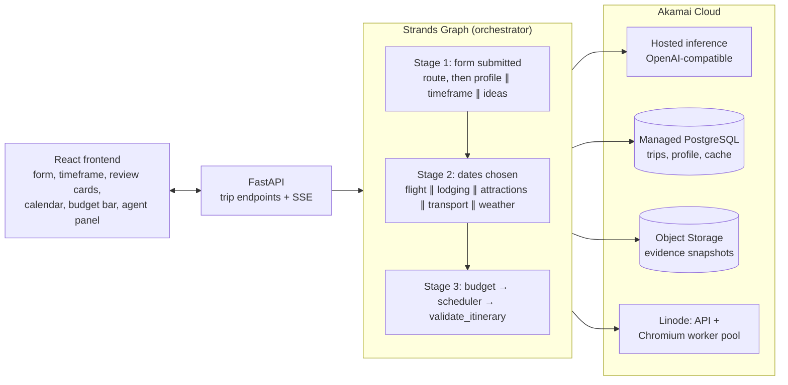

# Tripwright

An agentic trip planner built for Hack Midwest. Describe a trip (where from, where to, how long, budget), mark what sounds good on a list of places the agents research for you, invite the others coming along to do the same, and a team of AI agents plans it end to end: dates, flights, lodging, attractions, local transport and a day-by-day itinerary that fits the budget and has no scheduling conflicts. The agents gather live data by browsing provider sites, every price is stored with its source URL and a saved snapshot of the page it came from, and you approve, swap or remove every decision before anything is booked.

- **Strands Agents SDK** runs every agent: a Strands `Graph` dispatches specialists in parallel, each a Strands `Agent` with `@tool` functions, Pydantic structured output, hooks and streaming.
- **Akamai Cloud** hosts it: the hackathon's hosted inference endpoint is the model provider, a Linode runs the API and the Chromium workers, Managed PostgreSQL holds trip state, and Object Storage holds the evidence snapshots.

Demo scenario: 7 days in Japan from Kansas City, $2,500 total, with Tokyo Disneyland and Kyoto's Fushimi Inari marked must do. See [DEMO.md](DEMO.md) for the 3-minute script.

## Architecture



### Parallel stages

Each stage is one run of a Strands `Graph` ([orchestrator.py](backend/tripwright/orchestrator.py)). Nodes with no edge between them run in the same batch, in parallel.

```
Stage 1  form submitted      route ──┬── profile
                                     ├── timeframe (suggests 2-3 date windows)
                                     └── ideas (15-25 places everyone marks must do / interested / not for me)

Stage 2  everyone's in       route (re-planned from everyone's picks), then
                             flight ─────┐
                             lodging ────┤
                             attractions ┼──► budget ──► scheduler ──► validate
                             transport ──┤
                             weather ────┘

Stage 4  any user change     [only the affected specialists] ──► budget ──► scheduler ──► validate
```

Each specialist node wraps a Strands `Agent` in the orchestrator's review loop:

```
working ──► under review ──► accepted
               │
               ├─ deterministic checks: every id and URL was really returned by a tool,
               │  dates/cities match TripState, prices are plausible, budget share respected
               ├─ LLM judgment (orchestrator agent): plausibility and fit with the traveler
               │
               └─► sent back with specific feedback (up to 2 retries)
                      └─► fallback to the last accepted result (database, then demo fixtures),
                          flagged on the review card; or "pending" if there is none
```

A specialist has a time limit (`AGENT_TIMEOUT_S`). A node never raises, so a slow or failing specialist cannot stall the others: the orchestrator proceeds with what it has and flags the gap.

### The key rule: facts and math are code, not the model

- **Prices are never typed by the model.** Tools return a short table and keep the full results in a per-run context keyed by id. The agent answers with ids, reasoning and source URLs; Python joins them back to the real price, times, source URL and evidence snapshot ([toolbox.py](backend/tripwright/toolbox.py), [specialists.py](backend/tripwright/specialists.py)).
- **`validate_itinerary`** ([validate.py](backend/tripwright/validate.py)) is deterministic: overlapping activities, travel time between stops, opening hours and closed days, conflicts with flights and intercity travel, lodging covering every night, wrong-city days, missing must-sees, total cost against budget. It runs after every change.
- **Budget** ([budget.py](backend/tripwright/budget.py)) and **scheduling** ([scheduler.py](backend/tripwright/scheduler.py)) are deterministic graph nodes. If the plan is over budget, the optimizer proposes the fewest swaps that fit while keeping must-haves.

## How Strands is used

| Strands feature | Where |
| --- | --- |
| `GraphBuilder` / `Graph`, parallel entry nodes, conditional fan-in edges, `stream_async` | [orchestrator.py](backend/tripwright/orchestrator.py) `timeframe_graph`, `planning_graph`, `run` |
| Custom graph nodes (`MultiAgentBase`) | `SpecialistNode` (agent + review loop), `StepNode` (deterministic steps) |
| `Agent` with `structured_output_model` (Pydantic) | every specialist and the orchestrator's reviewer; schemas in [specialists.py](backend/tripwright/specialists.py) |
| `@tool` (class-based, async) | [toolbox.py](backend/tripwright/toolbox.py): `search_flights`, `search_hotels`, `search_airbnb`, `window_outlook`, `web_research`, `read_source`, `browse_page` |
| Hooks (`HookProvider`) | [llm.py](backend/tripwright/llm.py): `RateLimit` (shared requests/min pacing), `Activity` (streams tool calls to the UI, caps tool results for the 32k context) |
| Streaming (`agent.stream_async`) | `SpecialistNode._ask` forwards reasoning text to the activity panel |
| `OpenAIModel` provider with a custom `base_url` | [llm.py](backend/tripwright/llm.py) `make_model` |
| Vended tools (`strands_tools.tavily`) | [tools/research.py](backend/tripwright/tools/research.py) wraps `tavily_search` / `tavily_extract` |

Versions are pinned: `strands-agents==1.59.0`, `strands-agents-tools==0.8.9`.

## How Akamai is used

| Akamai service | Use | Config |
| --- | --- | --- |
| Hosted AI inference (OpenAI-compatible, `hackathon-chat`) | Model provider for every agent | `OPENAI_BASE_URL`, `OPENAI_API_KEY`, `CHAT_MODEL` |
| Compute (Linode `g6-standard-4`) | FastAPI, Strands agents and the headless Chromium worker pool, in one container | [deploy/deploy.sh](deploy/deploy.sh), [compose.yaml](compose.yaml) |
| Managed PostgreSQL | Trip state, traveler profile, tool-result cache, last accepted agent results | `DATABASE_URL` ([store.py](backend/tripwright/store.py)) |
| Object Storage | A screenshot or text snapshot of every results page; each price record carries its URL | `OBJ_*` ([evidence.py](backend/tripwright/evidence.py)) |

Variable names match the [Akamai starter kit](https://github.com/akamai-developers/akamai-workshop-hackmidwest), and the deploy scripts use the same region and `linode-cli` calls. The endpoint's limits shaped the design: 60 requests/min per team (the `RateLimit` hook), a 32k-token context (compact tool output), and chat completions only (so `OpenAIModel`, not the Responses API). It also rejects an empty `tools` array, which is fine here because every agent has at least its structured-output tool.

## Run locally

Requires Python 3.11+ and Node 20+.

```bash
cp .env.example .env          # add OPENAI_API_KEY (team key) and TAVILY_API_KEY; shell variables override .env

cd backend
python3 -m venv .venv
.venv/bin/pip install -e ".[dev]"
.venv/bin/playwright install chromium
.venv/bin/pytest                # 63 tests: validator, scheduler, budget, review loop, booking links, picks, API roles

cd ../frontend
npm install
npm run build                   # FastAPI serves frontend/dist

cd ..
backend/.venv/bin/uvicorn tripwright.api:app --app-dir backend --port 8000
```

Open http://localhost:8000. `GET /api/health` shows which services are live and which are on their local fallback (SQLite, evidence on disk). For frontend development run `npm run dev` in `frontend/`; it proxies `/api` to port 8000.

### Without keys, and DEMO_MODE

- **No `OPENAI_API_KEY`:** every specialist goes straight to its fallback. For the demo trip (Kansas City → Japan, 7 days) that is the result of a real live run on 2026-10-10, recorded in [fixtures/recorded.json](backend/tripwright/fixtures/recorded.json) and shown with a "saved result" flag. Any other trip shows the agents as pending.
- **`DEMO_MODE=true`:** tools never touch the network. They replay recorded results (same call, or the closest recorded call to the same tool). The agents still reason live if a key is set, so the demo survives a site changing or blocking us.
- **`RECORD_FIXTURES=true`:** live tool results and accepted agent results are also written to the fixtures file. To refresh the demo: set it, plan the demo trip once, then `cp -R data/evidence/* backend/tripwright/fixtures/evidence/`.

## Deploy on Akamai

Needs `linode-cli` configured with a token, and an SSH key at `~/.ssh/id_ed25519`. These create billable resources.

```bash
bash deploy/provision.sh   # Object Storage bucket + key, Managed PostgreSQL; writes OBJ_* and DATABASE_URL to .env
bash deploy/deploy.sh      # firewall, Linode, Docker; copies the code and .env; waits for /api/health
bash deploy/teardown.sh    # deletes everything labelled tripwright-*
```

## Safety and booking rules

- Agents never enter payment details or passwords and never create accounts. No tool can type into a page.
- "Booking" means a link. The **Finish** screen lists everything to book in order ([booking.py](backend/tripwright/booking.py)). Flight links open Google Flights on the route, dates, airline and traveler count; hotel links open the hotel's own page on the stay dates; Airbnb links carry dates and guests. Ticket and rail sites don't accept details in a URL, so those steps link to the right page and say exactly what to enter. The user books and pays on the provider's site.
- If a site blocks automation or shows a CAPTCHA, the tool raises `Blocked`, the failure is recorded, and the agent uses another provider or saved data. Nothing tries to hide the browser or get past bot detection.

## Project layout

```
backend/tripwright/
  models.py         TripState and every structured result
  validate.py       validate_itinerary (deterministic)
  budget.py         budget math and the swap optimizer
  scheduler.py      day frames and activity placement
  specialists.py    agent prompts, output schemas, deterministic review
  orchestrator.py   Strands graphs, review/rejection loop, fallback, user actions
  toolbox.py        the @tools agents call
  tools/            flights (Google Flights), lodging (Google Hotels, Airbnb), browser pool,
                    research (Tavily), places (Open-Meteo, Nominatim)
  llm.py            Akamai inference provider and shared hooks
  recorded.py       cache / DEMO_MODE replay / fixture recording
  store.py          PostgreSQL or SQLite
  evidence.py       Object Storage or local disk
  cards.py          review-screen cards
  booking.py        finish-screen checklist and detail-carrying provider links
  api.py            FastAPI + SSE
  fixtures/         recorded tool results, accepted results and evidence for the demo
backend/tests/      validator, scheduler, budget, orchestrator (scripted model)
frontend/           React + Vite
deploy/             Akamai provisioning and deploy scripts
```

## Where this differs from the brief

- **Hotels come from Google Hotels, not Booking.com.** Booking.com answers plain headless Chromium with an HTTP 502 block page. Per the rules above, the tool switches provider instead of working around it. Google Hotels prices are nightly "from" rates for its default of two adults.
- **`browse_page` replaces Strands' `LocalChromiumBrowser`.** In `strands-agents-tools` 0.8.9 an instance that is garbage-collected without a clean close hangs in its own cleanup, and `get_text` returns a whole page (about 60k characters). `browse_page` is a thin Playwright `@tool` on the shared worker pool that returns trimmed text and saves a screenshot.
- **The Strands Tavily tools are deprecated** (a warning from 0.8.9, an error log from 0.9.0; the suggested path is the Tavily MCP server). They are pinned and wrapped here.
- **Weather uses Open-Meteo through a small deterministic tool**, not the vended `http_request` (also deprecated), so the numbers reach the scheduler without passing through the model.
- **Hotel links rely on an undocumented Google Hotels URL parameter** (`ts`) to carry the stay dates. It was checked against live pages on 2026-10-10; if Google drops it, the link still opens the right hotel on default dates.
- **Return-flight times** come from a second search in the reverse direction, matched by airline. Google Flights only shows the paired return after a click-through, which was unreliable headless. The round-trip price is exact; the return time is typical for that carrier and is confirmed at checkout.
- **Travel times between stops are estimates** (great-circle distance at urban transit speed). There is no free transit-routing API for Japan. Intercity legs use the Transport agent's researched durations.
- **Budget optimizer, scheduler and weather are deterministic graph nodes**, not LLM agents, following the key rule.
- **Trip length:** `days` runs from leaving home to the flight home, so "7 days" from Kansas City is 6 nights in Japan.
- **Source and evidence links are not shown on the cards.** They were removed from the UI; every card in the API response still carries them (`sources[].url`, `sources[].evidence_url`).
- **Not built:** the monitor agent (stretch goal), and food is not part of the budget.
