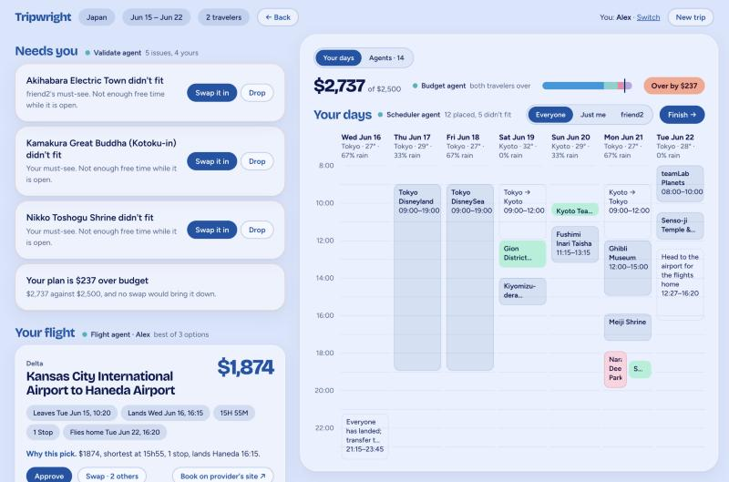
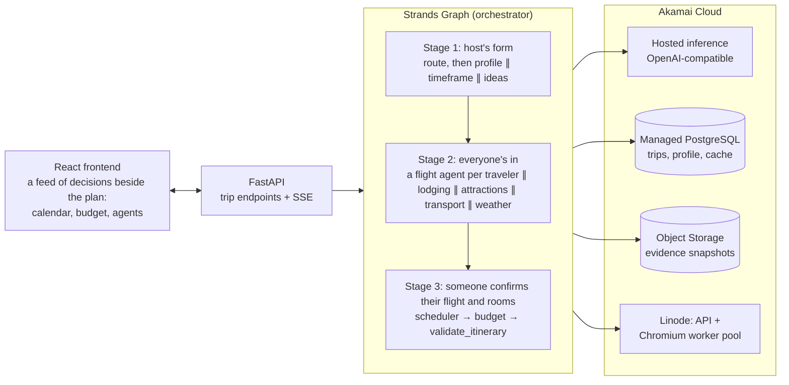

# Tripwright

An agentic trip planner built for Hack Midwest, for one traveler or a group. The host describes the trip (where from, where to, how long, budget) and invites the others with one link; each traveler opens it on their own device, adds their name, where they fly from and their budget, and from then on has their own link to the trip. They then mark a list of places the agents research for the destination as must do, interested or not for me. A team of AI agents then plans it end to end: dates, a flight, rooms and local transport for each traveler within their own budget, attractions for the group, and a day-by-day itinerary with no scheduling conflicts. Each traveler chooses their own flight and rooms before the days are planned around them. Everyone shares one itinerary while it fits; when it doesn't, someone splits off for an activity (or skips one they marked not for me) and regroups after. The agents gather live data by browsing provider sites, every price is stored with its source URL and a saved snapshot of the page it came from, and each traveler approves, swaps or removes their own decisions before anything is booked.

- **Strands Agents SDK** runs every agent: a Strands `Graph` dispatches specialists in parallel, each a Strands `Agent` with `@tool` functions, Pydantic structured output, hooks and streaming.
- **Akamai Cloud** hosts it: the hackathon's hosted inference endpoint is the model provider, a Linode runs the API and the Chromium workers, Managed PostgreSQL holds trip state, and Object Storage holds the evidence snapshots.

Demo scenario: 7 days in Japan from Kansas City, $2,500 total, with Tokyo Disneyland and Kyoto's Fushimi Inari marked must do. See [DEMO.md](DEMO.md) for the 3-minute script.



To run it, go to [Run locally](#run-locally). To put it on a server, go to [Deploy on Akamai](#deploy-on-akamai).

## How the screen works

The whole trip happens on one screen with two panes that scroll on their own:

- **The feed, on the left,** is where the agents report and ask for the next decision.
- **The board, on the right,** is the plan, filling in as you answer. A switch at its top swaps the plan for **Agents**: one card per agent with its status, what it found, how often the orchestrator sent its work back, and its tool log behind **Show details**.

A headline that an agent's work is behind names that agent, with a status dot and a few words on what it found or is doing (on a group trip, **Validate agent** then "5 issues, 4 yours"). Clicking that tag opens the agent's card on the board. Headlines with no agent behind them, such as the start form, the invite and the bookings, have no tag.

| Step | In the feed | On the board |
| --- | --- | --- |
| Start | The trip form, and **Use the demo trip** in the top bar | Where the route and days will appear |
| Picks | Places by category: **Must do**, **Interested** or **No**; **Add a place**; **More like my picks** | The draft plan, the tallies and **Save my picks** |
| Dates | One card per date window with weather, crowds and the cheapest fare found | The route |
| Who's coming | The invite link and everyone who has joined | The draft plan from everyone's picks |
| Agents working | One line per agent as it reports | The Agents tab, open |
| Choose | Your flight and a room for each stay, as selectable cards | The draft plan; once someone has confirmed and the days are planned around them, the days so far |
| Review | **Needs you** (must-sees that did not fit, your budget), your flight, your stays, getting around, and what was left off | Your budget by category and a week calendar: drag an activity to another day, or click one to swap it or take it off |
| Finish | Pay together (each traveler's share, and whether it is on hold or paid), then your bookings in order, then tickets. Flight and stay links open with the trip's details filled in; ticket and transport links open the provider's page, with a note on what to enter there. Places that need no ticket are listed without a link | The final days |

The design this was built from is in [design/](design/): the approved mockup is `direction-c-lilac.html`, and `implemented/` has screenshots of the running app.

## Architecture



### Parallel stages

Each stage is one run of a Strands `Graph` ([orchestrator.py](backend/tripwright/orchestrator.py)). Nodes with no edge between them run in the same batch, in parallel.

```
Stage 1  host's form         route ──┬── profile
                                     ├── timeframe (suggests 2-3 date windows)
                                     └── ideas (about 16 places everyone marks must do / interested / not for me)

         host picks dates, shares the invite link; each traveler joins from it on their own device and marks the places
         ("More like my picks" runs the ideas agent again for one traveler)

Stage 2  everyone's in       route (again, now with everyone's picks)
                             flight: Alex ──┐
                             flight: Sam ───┤
                             flight: Jo ────┤
                             lodging ───────┤   each traveler chooses their own flight and rooms
                             attractions ───┤   as soon as theirs are found
                             transport ─────┤
                             weather ───────┘

Stage 3  first confirm       scheduler ──► budget ──► validate   (and again on every later confirm)

Stage 4  any user change     [only the affected specialists] ──► scheduler ──► budget ──► validate
```

What is individual and what is shared:

- **Flights:** one agent per traveler, searching from that traveler's own origin within their own budget.
- **Lodging:** one agent researches what most travelers pick and searches each stay once; each traveler's room is then chosen from those options by their own nightly budget, in code ([specialists.py](backend/tripwright/specialists.py) `assign_rooms`).
- **Ideas:** one shared list of places, found by the ideas agent when the trip is created. Each traveler marks it on their own link (must do, interested, not for me), can add places, and can ask for more like their picks.
- **Flight and rooms:** each traveler confirms their own before the days are scheduled around them.
- **Transport:** each traveler gets their own copy of the legs, and can swap or remove one or add a rental car on their own budget.
- **Attractions:** planned for the group, by one agent per city on the route working at the same time (the model writes slowly, so two short lists finish sooner than one long one). Everyone's marks are merged and filed under the city each place is in, the lists are joined and reviewed as one, and each attraction comes back tied to who needs it, who wants it and who skips it.
- **Itinerary:** the scheduler ([scheduler.py](backend/tripwright/scheduler.py)) puts everything on one shared itinerary while it fits, needs before wants. Whoever marked a place not for me is free while the others go. Something only some travelers asked for that does not fit is scheduled for just them, during a group activity none of them asked for (or one they skip), and they regroup after. The group's day starts once the last person has landed and ends when the first person leaves for their flight home.
- **Budgets:** per traveler: their flight, their rooms, tickets for what they attend, and the transport legs they keep.

Each specialist node wraps a Strands `Agent` in the orchestrator's review loop:

```
working ──► under review ──► accepted
               │
               ├─ deterministic checks, every attempt: every id and URL was really returned by a
               │  tool, dates/cities match TripState, prices are plausible, budget share respected
               ├─ LLM judgment (orchestrator agent), first attempt only, for lodging, attractions and transport: plausibility and fit
               │
               └─► sent back with specific feedback (up to 2 retries)
                      └─► fallback to the last accepted result (database, then demo fixtures),
                          flagged on the review card; or "pending" if there is none
```

A specialist has a time limit (`AGENT_TIMEOUT_S`). A node never raises, so a slow or failing specialist cannot stall the others: the orchestrator proceeds with what it has and flags the gap.

### The key rule: facts and math are code, not the model

- **Flight and lodging prices, and the fare shown for each date window, are never typed by the model.** Tools return a short table and keep the full results in a per-run context keyed by id. The agent answers with ids, reasoning and source ids; Python joins them back to the real price, times, source URL and evidence snapshot ([toolbox.py](backend/tripwright/toolbox.py), [specialists.py](backend/tripwright/specialists.py)). Attraction ticket prices and transport fares are the exception: the agent reads the amount from a page it researched and gives that page's source id. Code checks that the id is one a tool returned and that the amount is in a plausible range; anything that fails is sent back or left out.
- **`validate_itinerary`** ([validate.py](backend/tripwright/validate.py)) is deterministic: nobody in two places at once, travel time between stops, opening hours and closed days, conflicts with flights and intercity travel, each traveler's lodging covering every night, wrong-city days, everyone attending what they marked must do and nobody sent to what they marked not for me, each traveler's cost against their budget. It runs after every change.
- **Budget** ([budget.py](backend/tripwright/budget.py)) and **scheduling** ([scheduler.py](backend/tripwright/scheduler.py)) are deterministic graph nodes. If a traveler is over budget, the optimizer proposes the fewest swaps of their own flight and rooms that fit; shared attractions are left alone.
- **The landing day comes from real flight results**, not from the model: it is read from a flight search before lodging dates are set.

## How Strands is used

| Strands feature | Where |
| --- | --- |
| `GraphBuilder` / `Graph`, parallel entry nodes, conditional fan-in edges, `stream_async` | [orchestrator.py](backend/tripwright/orchestrator.py) `timeframe_graph`, `planning_graph`, `run` |
| Custom graph nodes (`MultiAgentBase`) | `SpecialistNode` (agent + review loop), `StepNode` (deterministic steps) |
| `Agent` with `structured_output_model` (Pydantic) | every specialist and the orchestrator's reviewer; schemas in [specialists.py](backend/tripwright/specialists.py) |
| `@tool` (class-based, async) | [toolbox.py](backend/tripwright/toolbox.py): `search_flights`, `search_hotels`, `search_airbnb`, `window_outlook`, `web_research`, `read_source`, `browse_page` |
| Hooks (`HookProvider`) | [llm.py](backend/tripwright/llm.py): `RateLimit` (shared requests/min pacing), `Activity` (streams tool calls to the UI, caps tool results for the 32k context) |
| Streaming (`agent.stream_async`) | `SpecialistNode._ask` forwards reasoning text to that agent's log on the board's Agents tab |
| `OpenAIModel` provider with a custom `base_url` | [llm.py](backend/tripwright/llm.py) `make_model` |
| Vended tools (`strands_tools.tavily`) | [tools/research.py](backend/tripwright/tools/research.py) wraps `tavily_search` / `tavily_extract` |

Versions are pinned: `strands-agents==1.59.0`, `strands-agents-tools==0.8.9`.

## How Akamai is used

| Akamai service | Use | Config |
| --- | --- | --- |
| Hosted AI inference (OpenAI-compatible, `hackathon-chat`) | Model provider for every agent | `OPENAI_BASE_URL`, `OPENAI_API_KEY`, `CHAT_MODEL` |
| Compute (Linode `g6-standard-4`) | FastAPI, Strands agents and the headless Chromium worker pool, in one container | [deploy/deploy.sh](deploy/deploy.sh), [compose.yaml](compose.yaml) |
| Managed PostgreSQL | Trip state, traveler profile, tool-result cache, last accepted agent results | `DATABASE_URL` ([store.py](backend/tripwright/store.py)) |
| Object Storage | A screenshot or text snapshot of every results page; each price record carries its URL | `OBJ_*` ([evidence.py](backend/tripwright/evidence.py)) |

Variable names match the [Akamai starter kit](https://github.com/akamai-developers/akamai-workshop-hackmidwest), and the deploy scripts use the same region and `linode-cli` calls. The endpoint's limits shaped the design: 60 requests/min per team (the `RateLimit` hook), a 32k-token context (compact tool output), and chat completions only (so `OpenAIModel`, not the Responses API). It also rejects an empty `tools` array, which is fine here because every agent has at least its structured-output tool.

## Run locally

Requires Python 3.11+ and Node 22.12 or newer (Node 20.19 or a later 20.x also works; that is the range Vite 8 supports).

**First time:**

```bash
cp .env.example .env          # add OPENAI_API_KEY (team key) and TAVILY_API_KEY; shell variables override .env

cd backend
python3 -m venv .venv
.venv/bin/pip install -e ".[dev]"
.venv/bin/playwright install chromium

cd ../frontend
npm install
npm run build                   # FastAPI serves frontend/dist
```

**Every time,** from the project root:

```bash
backend/.venv/bin/uvicorn tripwright.api:app --app-dir backend --port 8000
```

Open http://localhost:8000, click **Use the demo trip**, then **Start planning**.

- `GET /api/health` shows which services are live and which are on their local fallback (SQLite, evidence on disk).
- **Which database:** a local server uses the SQLite file `data/tripwright.db` and saves page snapshots to `data/evidence`. The hosted database and bucket are named in `.env.hosted`, which only the deploy scripts read, so nothing you run on your own machine touches hosted trips.
- The server does not reload. Restart it after editing the backend, and run `npm run build` again after editing `frontend/src`.
- Restarting a server stops any agent run in progress: runs live in the server process.

### Work on the frontend

```bash
cd frontend
npm run dev                     # http://localhost:5173, with hot reload
```

The dev server sends `/api` to the backend on port 8000. To use a backend on another port, set `TRIPWRIGHT_BACKEND`, for example `TRIPWRIGHT_BACKEND=http://localhost:8001 npm run dev`.

### Tests

```bash
(cd backend && .venv/bin/python -m pytest -q)    # 111 tests: validator, scheduler, budget, review loop, booking links, group trips, picks, API roles
(cd frontend && npm run build)                   # the TypeScript check, then the build; there is no frontend test suite
```

Both lines run from the project root.

The tests always use a throwaway SQLite file, whatever `.env` says.

### A ready-made group trip

```bash
cd backend && .venv/bin/python -m tripwright.scenario
```

This creates a seven-traveler Japan trip with dates set and everyone's picks saved, and prints its links, so you can join as an eighth traveler or switch to the host and start planning.

- The research (flights, rooms, attractions, transport, weather) does not start until the host starts planning. Opening the trip does build the draft plan about ten seconds later, and joining or saving picks rebuilds it: with a key set, each build is one route planner call and one short note from the orchestrator.
- It writes to the SQLite file `data/tripwright.db`, the one a local server reads.

### Without keys, and DEMO_MODE

- **No `OPENAI_API_KEY`:** every specialist goes straight to its fallback. For the demo trip (Kansas City → Japan, 7 days) that is the result of a real live run on 2026-10-10, recorded in [fixtures/recorded.json](backend/tripwright/fixtures/recorded.json) and shown with a "saved result" flag, the list of places on the picks screen included. Any other trip shows the agents as pending.
- **`DEMO_MODE=true`:** tools never touch the network. They replay recorded results (same call, or the closest recorded call to the same tool). The agents still reason live if a key is set, so the demo survives a site changing or blocking us.
- **`RECORD_FIXTURES=true`:** live tool results and accepted agent results are also written to the fixtures file. To refresh the demo: start the server with `RECORD_FIXTURES=true` in front of the command. Plan the demo trip once, then `cp -R data/evidence/* backend/tripwright/fixtures/evidence/`. The list of places is the exception: if the database has one saved for a 7-day Japan trip in the last 30 days, it is reused and not recorded.

## Deploy on Akamai

Needs `linode-cli` configured with a token, and an SSH key at `~/.ssh/id_ed25519`. These create billable resources.

```bash
bash deploy/provision.sh   # Object Storage bucket + key, Managed PostgreSQL; writes OBJ_* and DATABASE_URL to .env.hosted
bash deploy/deploy.sh      # firewall, Linode, Docker; copies the code, .env and .env.hosted; waits for /api/health
bash deploy/teardown.sh    # deletes everything labelled tripwright-*
```

`deploy.sh` is also how you update a server that is already running: it reuses what exists, replaces the server's `backend/` and `frontend/` with the working folder's (uncommitted changes included, so check `git status` first), rebuilds the container and waits for `/api/health`. Rebuilding restarts the app, which stops any trip that is being planned at that moment.

The app answers on `http://<server-ip>:8000`. `linode-cli linodes list --label tripwright-app` prints the address.

## Safety and booking rules

- Agents never enter payment details or passwords and never create accounts. No tool can type into a page.
- "Booking" means a link. The **Finish** screen lists everything to book in order ([booking.py](backend/tripwright/booking.py)). Flight links open Google Flights on the route, dates, airline and traveler count; hotel links open the hotel's own page on the stay dates; Airbnb links carry dates and guests. Ticket and rail sites don't accept details in a URL, so those steps link to the right page and say exactly what to enter. The user books and pays on the provider's site.
- Paying together is test mode only. On **Finish**, each traveler approves their own share of the trip on a test card picked from a list ([payments.py](backend/tripwright/payments.py)). Approving places a hold; every card is charged at once when the whole group has approved, and if anyone backs out first, every hold is released. With `STRIPE_SECRET_KEY` set to a Stripe test key, each hold is a test-mode PaymentIntent (authorize now, capture later); without it the holds are kept in the trip. Live keys are refused, no card number is typed, no agent is involved and no money moves.
- If a site blocks automation or shows a CAPTCHA, the tool raises `Blocked`, the failure is recorded, and the agent uses another provider or saved data. Nothing tries to hide the browser or get past bot detection.

## Project layout

```
backend/tripwright/
  models.py         TripState and every structured result
  validate.py       validate_itinerary (deterministic)
  budget.py         budget math and the swap optimizer
  scheduler.py      day frames and activity placement
  specialists.py    agent prompts, output schemas, deterministic review
  orchestrator.py   Strands graphs, review/rejection loop, fallback, user actions
  toolbox.py        the @tools agents call
  tools/            flights (Google Flights), lodging (Google Hotels, Airbnb), browser pool,
                    research (Tavily), places (Open-Meteo, Nominatim)
  llm.py            Akamai inference provider and shared hooks
  recorded.py       cache / DEMO_MODE replay / fixture recording
  store.py          PostgreSQL or SQLite
  evidence.py       Object Storage or local disk
  cards.py          review-screen cards
  booking.py        finish-screen checklist and detail-carrying provider links
  payments.py       pay together: a hold per traveler on a test card, charged when everyone is in
  api.py            FastAPI + SSE
  fixtures/         recorded tool results, accepted results and evidence for the demo
backend/tests/      validator, scheduler, budget, orchestrator (scripted model)
frontend/src/
  App.tsx           the top bar, and which screen a trip is on
  shell.ts          what every screen shares: the trip, who is looking, the agents, the board's open tab
  useTrip.ts        loads the trip and follows its event stream
  styles.css        the one stylesheet: colours, type and every component
  components/       one file per screen (Start, Picks, Timeframe, Gathering, Join, Working, Choose, Review, Finish)
                    and the shared pieces (Board, Agents, Calendar, Days, DraftPlan, Route)
design/             the approved mockup, the handoff it was built from, and screenshots of the result
deploy/             Akamai provisioning and deploy scripts
```

## Where this differs from the brief

- **Hotels come from Google Hotels, not Booking.com.** Booking.com answers plain headless Chromium with an HTTP 502 block page. Per the rules above, the tool switches provider instead of working around it. Google Hotels prices are nightly "from" rates for its default of two adults.
- **`browse_page` replaces Strands' `LocalChromiumBrowser`.** In `strands-agents-tools` 0.8.9 an instance that is garbage-collected without a clean close hangs in its own cleanup, and `get_text` returns a whole page (about 60k characters). `browse_page` is a thin Playwright `@tool` on the shared worker pool that returns trimmed text and saves a screenshot.
- **The Strands Tavily tools are deprecated** (a warning from 0.8.9, an error log from 0.9.0; the suggested path is the Tavily MCP server). They are pinned and wrapped here.
- **Weather uses Open-Meteo through a small deterministic tool**, not the vended `http_request` (also deprecated), so the numbers reach the scheduler without passing through the model.
- **Hotel links rely on an undocumented Google Hotels URL parameter** (`ts`) to carry the stay dates. It was checked against live pages on 2026-10-10; if Google drops it, the link still opens the right hotel on default dates.
- **Return-flight times** come from a second search in the reverse direction, matched by airline. Google Flights only shows the paired return after a click-through, which was unreliable headless. The round-trip price is exact; the return time is typical for that carrier and is confirmed at checkout.
- **Travel times between stops are estimates** (great-circle distance at urban transit speed). There is no free transit-routing API for Japan. Intercity legs use the Transport agent's researched durations.
- **Budget optimizer, scheduler and weather are deterministic graph nodes**, not LLM agents, following the key rule. The scheduler runs before the budget step, because a traveler's ticket costs depend on which activities they attend.
- **Lodging is one agent, not one per traveler.** Each traveler still gets their own room by their own budget, but the pick is made in code from one agent's research. Running a lodging agent per traveler overloaded the shared endpoint in live tests.
- **The reviewer model judges lodging, attractions and transport results, once each.** In live runs it sent back correct results for reasons that were not true, so the code checks run on every attempt and the model's judgment only on the first. Flights, the route, the profile, the date windows and the list of places are checked by code only. Flights were judged at first and no longer are: every fact in a flight result comes from the search, and an over-budget first pick is reordered in code.
- **Invites are a share link with no login.** Anyone with the invite link can join until planning starts, and then has their own link. The host's controls (choosing the dates, removing a traveler, starting planning) show only on the host's link, and the API refuses them from anyone else. This keeps people to their own choices rather than securing them: the bare trip link asks "Who are you?" and lets anyone pick any traveler, the host included.
- **Trip length:** `days` runs from leaving home to the flight home, so "7 days" from Kansas City is 6 nights in Japan.
- **Source and evidence links are not shown on the cards.** They were removed from the UI; every card in the API response still carries them (`sources[].url`, `sources[].evidence_url`).
- **A simple map.** The design mockups show one as a placeholder; the draft plan has a Leaflet map on OpenStreetMap tiles with a pin for every place on the list, your must-do places filled, under the route as a row of cities with the nights in each. The final days have no map.
- **Not built:** the monitor agent (stretch goal), and food is not part of the budget.
